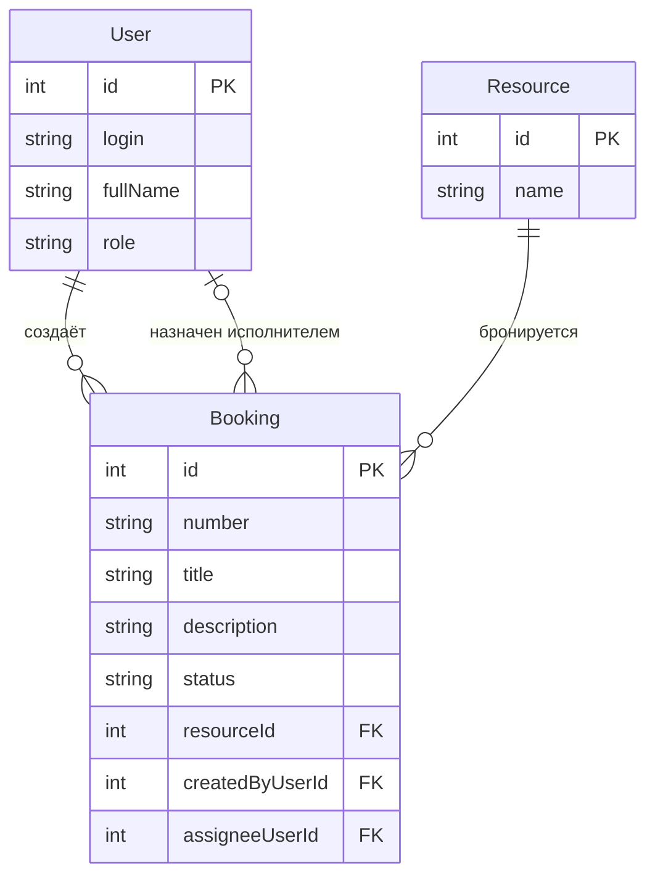

# Модель данных

## Словарь проекта

| Термин курса | Термин моей темы |
|-|-|
| Ticket | бронь (booking) |
| Site | ресурс библиотеки (книга или рабочее место) |
| User | читатель / библиотекарь / заведующий |

Дальше везде используем: **бронь**, **ресурс**, **пользователь**.

## ER-модель

Связи словами:

- один ресурс - много броней (1:N, `Booking.resourceId → Resource.id`);
- один пользователь (читатель) создаёт много броней (1:N, `Booking.createdByUserId → User.id`);
- один пользователь (библиотекарь) может быть назначен на много броней (1:N, `Booking.assigneeUserId → User.id`);
- у новой брони исполнитель может отсутствовать (`assigneeUserId IS NULL`).

## Поля главного объекта (Booking)

| Поле | Тип | Ключ | Назначение |
|-|-|-|-|
| id | int | PK | машинный идентификатор |
| number | string | | человеческий номер, например BR-0001 |
| title | string(5–80) | | заголовок брони |
| description | string(10–500) | | описание |
| status | enum | | New, InProgress, Closed, Cancelled |
| resourceId | int | FK → Resource.id | что бронируем |
| createdByUserId | int | FK → User.id | кто создал |
| assigneeUserId | int, nullable | FK → User.id | назначенный библиотекарь |

## Справочник и пользователь

| Сущность | Поля | PK |
|-|-|-|
| Resource | id, name | id |
| User | id, login, fullName, role | id |

`id` и `number` - разные поля: `id` машинный, `number` человеческий для отображения.

## Проверка 3НФ

Название ресурса хранится в сущности Resource один раз. Booking содержит
внешний ключ `resourceId`, а не текст названия. При переименовании ресурса
меняется одна строка в Resource, поэтому текст названия не дублируется
в бронях.